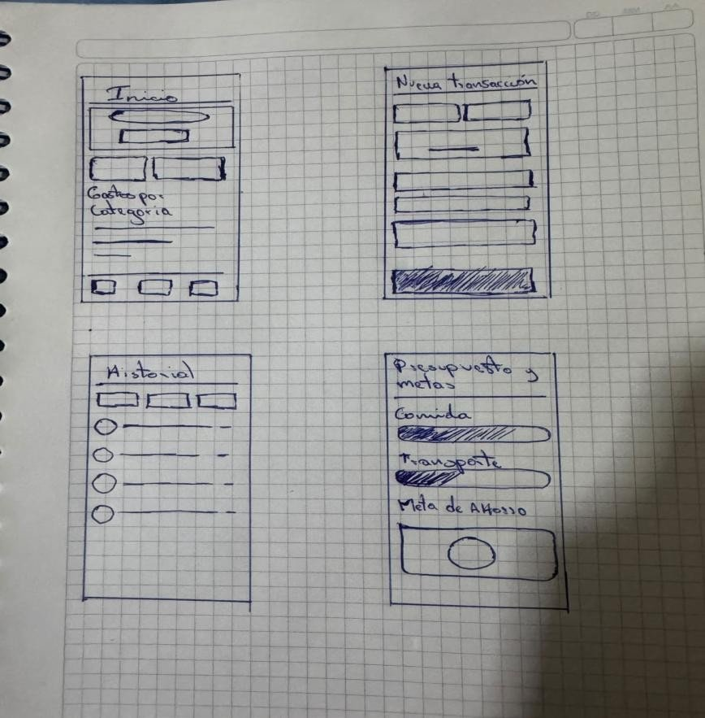
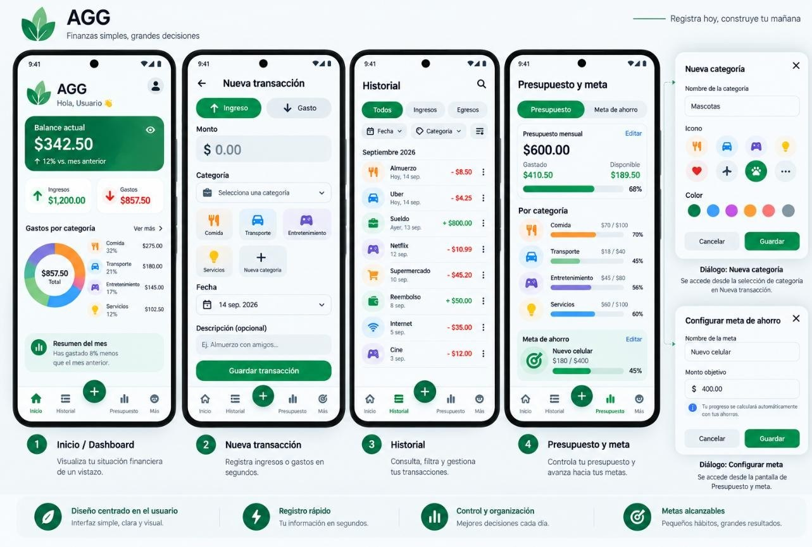
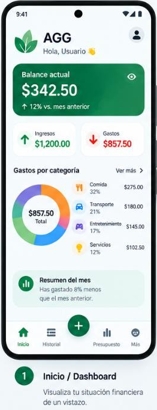
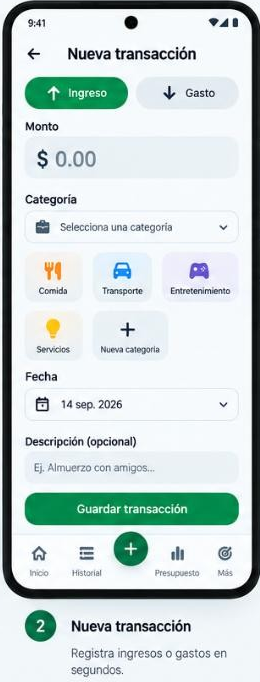
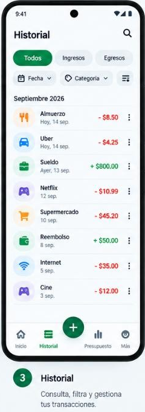
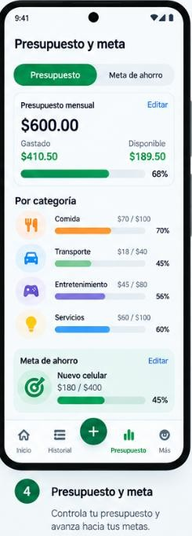
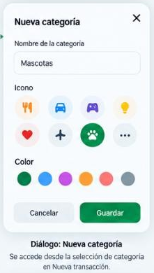
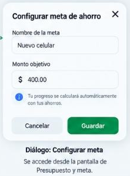

# Plan de desarrollo — AGG

> **AGG** — *Finanzas simples, grandes decisiones.*
> Aplicación móvil que permite registrar, categorizar y visualizar ingresos y gastos diarios para mantener el control del presupuesto personal de forma simple y visual.

**Asignatura:** Desarrollo de Aplicaciones Móviles — Trabajo Autónomo, segunda etapa (entrega SEMANA 8)
**Integrantes:** Danny Espinoza · Raúl Cedeño · Wagner Zambrano
**Repositorio (único, no cambiarlo):** https://github.com/Rackaras/AGG
**Fecha objetivo de finalización:** 21/10/2026

---

## 1. Reglas del trabajo que no podemos olvidar

| Regla del documento | Consecuencia |
|---|---|
| Usar **el mismo repositorio** durante todo el proyecto | Cambiar de repo = **−50 %** de la nota grupal |
| **Cada integrante debe registrar participación** (commits) en el repo | Quien no tenga commits = **−100 %** de su nota |
| Todos deben poder explicar **cualquier capa** (UI, ViewModel, Repositorio, BD) en el pitch | El docente pregunta a cualquiera |
| Cada estudiante sube el Word al aula virtual | Sin subirlo, no hay calificación |

---

## 2. Cómo clonar y abrir el proyecto

### Requisitos
- **Android Studio** actualizado (incluye el JDK que necesita Gradle; no hace falta instalar Java aparte).
- **Git** instalado y una cuenta de GitHub con acceso de colaborador al repo (Raúl envía la invitación desde *Settings → Collaborators*; acéptenla desde el correo).
- Emulador o dispositivo físico con **Android 8.0 (API 26)** o superior.

### Pasos
```bash
git clone https://github.com/Rackaras/AGG.git
```
1. Android Studio → **File → Open** → seleccionar la carpeta `AGG` clonada.
2. Esperar a que termine el **Gradle Sync** (la primera vez descarga dependencias, puede tardar varios minutos).
   - Si aparecen imports en rojo (`Unresolved reference`), ejecutar **File → Sync Project with Gradle Files**.
3. **Build → Make Project** (Ctrl+F9) y luego **Run 'app'** (▶).
4. Debe aparecer la pantalla verde con *“AGG · Finanzas simples, grandes decisiones”* (pantalla temporal del Sprint 0).

> `local.properties` lo genera Android Studio automáticamente con la ruta de **tu** SDK; está en `.gitignore` y **no se sube**.

### Configurar tu identidad de Git (una sola vez)
Usen el mismo correo de su cuenta de GitHub; si no, los commits no cuentan como suyos:
```bash
git config --global user.name "Tu Nombre"
git config --global user.email "tu-correo-de-github@ejemplo.com"
```

---

## 3. Flujo de trabajo con Git

1. Siempre partir de `main` actualizado:
   ```bash
   git checkout main
   git pull
   git checkout -b feature/s3-dashboard
   ```
2. Trabajar y hacer commits pequeños con **Conventional Commits en inglés**:
   - `feat(home): show monthly balance card with change vs previous month`
   - `fix(history): keep category filter after deleting a transaction`
   - `test(dao): verify TransactionDao emits after insert`
   - Tipos: `feat`, `fix`, `refactor`, `test`, `docs`, `build`, `chore`, `style`.
3. Subir la rama y abrir un **Pull Request** hacia `main` en GitHub:
   ```bash
   git push -u origin feature/s3-dashboard
   ```
4. **Otro integrante revisa** el PR (comentario o *Approve*) y se hace *Merge*. Así todos quedan registrados en el historial.
5. Reglas:
   - `main` **siempre debe compilar** (probar *Make Project* antes de abrir el PR).
   - Nunca hacer `push --force` a `main`.
   - No subir carpetas `build/`, `.apk`, `local.properties` ni llaves.
   - Si hay conflicto: `git pull origin main` en tu rama, resolver en Android Studio (*Git → Resolve Conflicts*) y volver a subir.

---

## 4. Arquitectura (lo que evalúa la rúbrica)

```
UI (Compose)                    Presentación           Dominio            Datos
XxxRoute (stateful) ──► XxxViewModel ──► UseCase ──► Repository (interfaz)
   │ collectAsStateWithLifecycle()     StateFlow<UiState>          │
   ▼                                                    RepositoryImpl ──► DAO ──► Room (SQLite)
XxxScreen (stateless) ──► subcomponentes (solo estado inmutable + lambdas)
```

| Paquete (`com.agg.app`) | Contenido |
|---|---|
| `data/local/entity` | `CategoryEntity`, `TransactionEntity`, `BudgetEntity`, `SavingsGoalEntity` |
| `data/local/dao` | DAOs: lecturas `Flow<T>`, escrituras `suspend fun` |
| `data/local` | `AggDatabase` (+ categorías predefinidas al crear la BD) |
| `data/mapper` | Conversión entidad ⇄ modelo de dominio |
| `data/repository` | `*RepositoryImpl` |
| `domain/model` | Modelos que usa la UI (`Transaction`, `Category`, `Budget`, `SavingsGoal`…) |
| `domain/repository` | Interfaces de repositorio |
| `domain/usecase` | Casos de uso con `operator fun invoke` |
| `di` | Módulos de Hilt (`DatabaseModule`, `RepositoryModule`) |
| `ui/theme`, `ui/components`, `ui/navigation`, `ui/common` | Tema M3, componentes reutilizables, NavHost, `UiState` |
| `ui/home`, `ui/transaction`, `ui/history`, `ui/budget`, `ui/more` | Una carpeta por pantalla: `Route`, `Screen`, `ViewModel`, `UiState` |

### Reglas obligatorias (cada una vale puntos)

| # | Criterio de rúbrica | Pts | Regla para el código |
|---|---|---|---|
| 1 | UI & State Hoisting | 2.5 | Todo en Compose + Material 3. `XxxRoute` es el **único** composable que recibe el ViewModel y usa `collectAsStateWithLifecycle()`. `XxxScreen` y sus hijos solo reciben **estado inmutable y lambdas**. **Prohibido** pasar el ViewModel a un hijo y usar `collectAsState()`. |
| 2 | MVVM & estado reactivo | 2.0 | Un ViewModel por pantalla. Expone **un solo** `StateFlow<XxxUiState>` (`Loading` / `Success` / `Error`). `MutableStateFlow` siempre `private`. Eventos puntuales (Snackbar, volver atrás) con `Channel`. Cambios en `viewModelScope.launch`. |
| 3 | Room & SSOT | 2.5 | Lecturas devuelven `Flow<T>`. Escrituras `suspend fun`. **Prohibido** `runBlocking` y `allowMainThreadQueries()`. |
| 4 | Repositorio | 1.5 | Interfaz + `Impl`. El repositorio devuelve **modelos de dominio**, nunca entidades. El ViewModel **nunca** ve un DAO ni la base de datos. |
| 5 | Navegación & DI | 1.5 | Un único `NavHost` con rutas `@Serializable` (type-safe). Todo se inyecta con Hilt (`@HiltViewModel`, `@Inject constructor`). **Prohibido** `MiRepositorio()` a mano. |
| + | WindowSizeClass | +0.4 | En tablet/horizontal: `NavigationRail` y layouts en dos columnas. |
| + | Adaptive Icon | +0.3 | Ícono con capas `background`/`foreground` vectoriales (`.xml`). |
| + | Use Cases | +0.3 | Validaciones y cálculos (alertas de presupuesto, progreso de meta) en casos de uso. |

**Datos de dinero:** se guardan como `Long` en **centavos** (ej. $8.50 → `850`) para evitar errores de decimales. Las fechas se guardan como `epochDay` (`LocalDate`).

---

## 5. Requisitos funcionales → pantallas

| RF | Descripción | Pantalla / componente |
|---|---|---|
| RF01 / RF02 | Registrar ingreso / egreso (monto, fecha, categoría, descripción opcional) | Nueva transacción |
| RF03 | Balance actual visible en la pantalla principal | Inicio |
| RF04 | Categorías predefinidas + personalizadas | Nueva transacción → diálogo *Nueva categoría*; Más → Categorías |
| RF05 | Gráfico de gastos por categoría | Inicio (dona dibujada con `Canvas`) |
| RF06 | Presupuesto mensual general o por categoría | Presupuesto y meta |
| RF07 | Aviso al acercarse (≥ 80 %) o superar (≥ 100 %) el presupuesto | Snackbar + notificación local al guardar un gasto |
| RF08 | Historial filtrable por fecha, categoría y tipo | Historial |
| RF09 | Editar / eliminar transacción | Historial (menú ⋮) → Nueva transacción en modo edición |
| RF10 | Resumen de cierre mensual vs mes anterior | Inicio (tarjeta) + pantalla Resumen mensual |
| RF11 | Meta de ahorro con progreso | Presupuesto y meta → diálogo *Configurar meta* |
| RF12 | Registro rápido (solo monto y categoría obligatorios) | Botón central **+** y formulario mínimo |

---

## 6. Diseño de referencia

La implementación debe seguir el prototipo de alta fidelidad: verde AGG como color principal, tarjetas redondeadas, íconos de categoría con color propio y barra inferior con botón central **+**.

### Prototipo de baja fidelidad


### Prototipo de alta fidelidad


### Pantallas a implementar

| Inicio / Dashboard | Nueva transacción | Historial | Presupuesto y meta |
|---|---|---|---|
|  |  |  |  |
| RF03, RF05, RF10 | RF01, RF02, RF04, RF12 | RF08, RF09 | RF06, RF07, RF11 |

| Diálogo: Nueva categoría | Diálogo: Configurar meta |
|---|---|
|  |  |
| Se abre desde la selección de categoría en *Nueva transacción* (RF04) | Se abre desde *Presupuesto y meta* (RF11) |

**Navegación inferior:** Inicio · Historial · **+** (Nueva transacción) · Presupuesto · Más.
**Más** incluye: Categorías, Resumen mensual y Acerca de.

---

## 7. Sprints y responsables

Cada sprint se trabaja en su propia rama `feature/…` y se integra con un PR revisado por otro integrante. Después del Sprint 1, los sprints 2, 3 y 5 pueden avanzar **en paralelo**, porque todos dependen solo de la capa de datos y de la navegación base.

| Sprint | Fechas | Responsable | Rama | Entregable |
|---|---|---|---|---|
| S0 · Setup | ✅ 07–13/10 | Raúl | `main` | Proyecto, dependencias, Hilt, tema AGG, README |
| S1 · Datos + navegación base | 13–14/10 | **Raúl** | `feature/s1-data-layer` | Entidades, DAOs, `AggDatabase` con categorías semilla, mappers, repositorios (interfaz + Impl), módulos Hilt, `UiState` común, `NavHost` con barra inferior y pantallas vacías, pruebas de DAO |
| S2 · Nueva transacción | 15–16/10 | **Danny** | `feature/s2-transaction-form` | Formulario crear/editar (RF01, RF02, RF12), selector de categoría, diálogo *Nueva categoría* (RF04), `AddTransactionUseCase` con validaciones |
| S3 · Inicio / Dashboard | 15–16/10 | **Wagner** | `feature/s3-dashboard` | Tarjeta de balance (RF03), ingresos/gastos del mes, gráfico de dona (RF05), tarjeta *Resumen del mes* (RF10) |
| S4 · Historial | 17–18/10 | **Danny** | `feature/s4-history` | Lista agrupada por mes, pestañas Todos/Ingresos/Egresos, filtros de fecha y categoría (RF08), editar/eliminar con *Deshacer* (RF09) |
| S5 · Presupuesto y meta | 17–18/10 | **Wagner** | `feature/s5-budget-goal` | Presupuesto general y por categoría (RF06), alertas + notificación (RF07), meta de ahorro y progreso (RF11) |
| S6 · Extras + Más | 19–20/10 | **Raúl** | `feature/s6-adaptive` | `WindowSizeClass` (NavigationRail, layouts de dos columnas), Adaptive Icon vectorial, pantallas Resumen mensual y Categorías |
| S7 · QA y entrega | 21/10 | **Todos** | `main` | Prueba offline completa, revisión de la rúbrica, Word (sección *Segunda etapa* + URL del repo), ensayo del pitch |

**Revisiones cruzadas:** Danny revisa los PR de Wagner, Wagner los de Raúl y Raúl los de Danny. Así cada uno lee código de otras capas y puede responder en el pitch.

---

## 8. Definición de “terminado” (checklist para cada PR)

- [ ] Compila (`Build → Make Project`) y la app abre sin errores.
- [ ] La pantalla tiene `XxxRoute` (con ViewModel) y `XxxScreen` (sin ViewModel), y la `XxxScreen` tiene un `@Preview`.
- [ ] Ningún composable hijo recibe un `ViewModel`.
- [ ] El estado se lee con `collectAsStateWithLifecycle()`.
- [ ] El ViewModel expone **un** `StateFlow` y el `MutableStateFlow` es `private`.
- [ ] El ViewModel solo usa repositorios o use cases inyectados, nunca DAOs.
- [ ] Las escrituras a la BD son `suspend` y las lecturas son `Flow`.
- [ ] Textos visibles en `strings.xml` y colores del `MaterialTheme`, sin valores sueltos.
- [ ] La pantalla tiene fondo opaco (su raíz es un `Scaffold` o `Surface`); si no, durante la animación del formulario se ve la pantalla de atrás.
- [ ] Probado en el emulador: los datos persisten al cerrar y abrir la app.
- [ ] Mensaje de commit con Conventional Commits.

---

## 9. Preparación del pitch (5 minutos)

| Tiempo | Contenido | Quién |
|---|---|---|
| 1 min | Problema (personas Belén y Leonardo) y solución AGG | Danny |
| 2 min | **Demo en vivo:** registrar gasto → cerrar la app → modo avión → abrir y ver los datos y el gráfico actualizados; navegar entre pantallas | Wagner |
| 2 min | **Código:** Route vs Screen, `StateFlow` + `Flow` desde el DAO hasta la UI, inyección con Hilt | Raúl |

Antes del turno: emulador encendido con datos de ejemplo y el proyecto abierto en Android Studio en los archivos que se van a mostrar.
